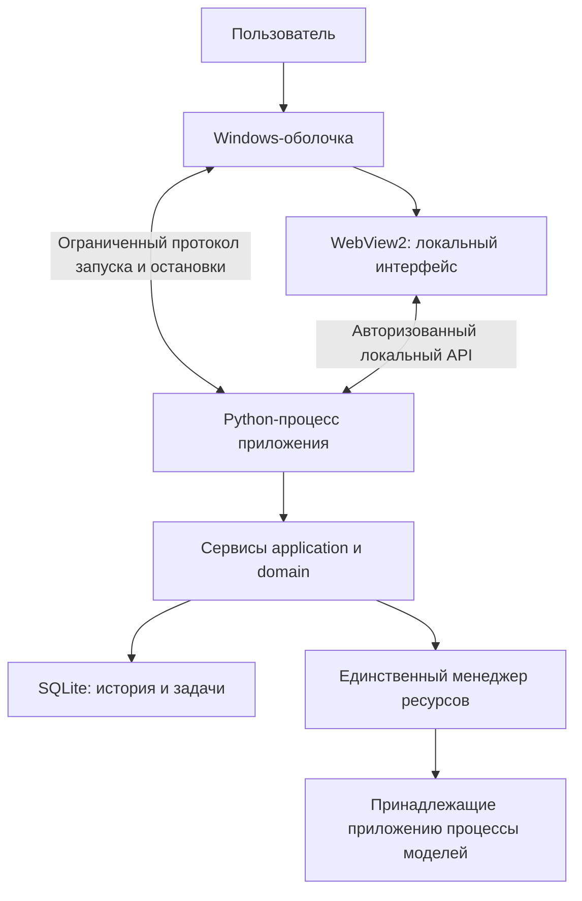

# Настольный Jarvis: предлагаемая архитектура

Дата: 9 октября 2026. Статус: предложение по следующему этапу, основанное на проверке текущего кода. Новая оболочка и установщик ещё не реализованы. Это документ для выбора направления; он не заменяет действующие правила ядра в `ARCHITECTURE.md`.

## Рекомендация

Сохранить Python-ядро, SQLite, управление задачами и моделями. Создать небольшую Windows-оболочку на C#/.NET с прямым использованием WebView2 и включить её, интерфейс и необходимые среды выполнения в установочный пакет. HTML/CSS/JavaScript остаются способом отображения интерфейса. Оболочка отвечает за запуск, разрешения, файловые операции и жизненный цикл окна.

Это выбор Windows-ориентированной оболочки для существующего приложения. Основание — прямой доступ к документированным событиям WebView2 и контролируемый запуск процессов. Снижение памяти относительно текущей реализации пока не доказано: его необходимо измерить на прототипе до переноса остальных функций.

## Что установлено по текущей реализации

| Наблюдение | Причина в коде | Значение для решения |
| --- | --- | --- |
| При записи появляется `127.0.0.1 wants to use your microphones` | `app.js` вызывает `getUserMedia`; `desktop_host.py` не обрабатывает `PermissionRequested` | Запрос остаётся на стандартном интерфейсе движка; можно перенести решение и оформление в оболочку |
| Пользователю не нравятся окна при прикреплении и скачивании файла | Прикрепление использует HTML file input; загрузки pywebview открывают WinForms `SaveFileDialog` | Кнопки и уведомления оформляются в Jarvis; выбор пути остаётся явным действием через стандартный диалог Windows |
| При запуске существует отдельное техническое окно | `interfaces/desktop.py` создаёт Tk-контроллер; основное окно открывается после готовности сервера | Нужен один видимый интерфейс от запуска до завершения |
| Разрешения могут запрашиваться после каждого запуска | Для каждого запуска создаётся временный приватный WebView-профиль | Нужна явно определённая политика разрешений; смена профиля не должна быть случайным способом управления согласием |
| Ярлык зависит от проекта и его окружения | `Jarvis.pyw`, `.venv`, пути в `pyvenv.cfg` и профилях | Нужна поставка управляемого внутреннего runtime и проверка на машине без среды разработки |
| Ядро не импортирует инфраструктуру или интерфейсы | Проверены импорты `application` и `domain` | Оболочка заменяется без переписывания истории, задач и инференса |

По последнему уточнению пользователя «при загрузке» означает работу с файлами, а не запуск приложения. Запуск включён в план отдельно, поскольку текущая реализация также использует там Tk.

## Сравнение вариантов

| Вариант | Преимущества | Затраты и ограничения | Оценка |
| --- | --- | --- | --- |
| Доработать текущую Python/pywebview-оболочку | Быстрее исправить отдельные элементы; минимум изменений | Остаются Tk, Python/.NET-взаимодействие и зависимость от внутренних объектов обёртки; упаковку всё равно надо проектировать | Возможен как промежуточный этап |
| Полностью нативный Windows-интерфейс | Нет браузерного движка для чата; потенциально меньше расход интерфейса | Переписывание редактора, отображения ответов, картинок, истории, аудио и взаимодействий; размер экономии ещё надо измерить | Имеет смысл, если WebView2 не проходит ресурсные требования |
| Нативная Windows-оболочка + WebView2 + существующее ядро | Сохраняет веб-интерфейс; прямое управление системными функциями и запуском | Два языка и протокол жизненного цикла; браузерный движок остаётся; необходимы испытания совместимости и упаковки | Рекомендуемый первый прототип |

Упаковка в установщик сама по себе не улучшает архитектуру. Полная перепись интерфейса сама по себе не гарантирует надёжность или меньшую память.

## Границы компонентов

- Windows-оболочка владеет окном, запросами системных разрешений, стандартными файловыми диалогами и деревом своего Python-процесса. Дочерний процесс назначается в kill-on-close Job Object при создании, без breakaway. Совместимость вложенных Job Objects с действующим супервизором моделей проверяется до миграции.
- Python-процесс по-прежнему единолично управляет SQLite, заданиями, контекстом, политиками инструментов, GPU-блокировкой и моделями. Оболочка не открывает базу и не запускает модели самостоятельно.
- Веб-интерфейс отображает данные и отправляет команды через существующий защищённый API. Политики, разрешения на инструменты и переходы заданий не переносятся в JavaScript.
- Канал оболочки с сервером ограничен запуском, готовностью, состоянием и остановкой. Он имеет версию протокола; несовпадение версий даёт понятную ошибку. Токены передаются через приватный канал, а не командную строку. Бизнес-API сохраняет сессию, CSRF, проверку Host/Origin и ограничение размеров.
- Если нужны сообщения от страницы к оболочке, допускается только небольшой перечень типизированных команд, например ответ на конкретный активный запрос разрешения. Проверяются исходный документ, идентификатор запроса и актуальность окна. Универсальный доступ к Python, shell, произвольному пути или выполнению кода не предоставляется.

## Как должны выглядеть микрофон и работа с файлами

**Микрофон.** Первое обращение показывает внутри Jarvis понятный запрос на русском: зачем требуется запись, кнопки разрешения и отказа. Разрешение действительно только для ожидаемого документа Jarvis и только после явного действия пользователя. При отсутствии решения, закрытии окна или смене документа запрос завершается отказом. Камера и другие неиспользуемые разрешения не выдаются. Запись имеет заметный индикатор и кнопку остановки; закрытие/ошибка освобождает микрофон. Настройки приватности Windows остаются обязательными.

Для первого прототипа согласие действует на текущий сеанс. Постоянное «запомнить выбор» добавляется только вместе с явным управлением и отзывом в настройках Jarvis. Нельзя просто автоматически разрешать микрофон всем страницам или подавлять запрос без согласия пользователя. WebView2 предоставляет `PermissionRequested`, отсрочку решения и настройку сохранения разрешений; эти возможности проверены по документации Microsoft.

**Прикрепление.** В чате используется оформленная кнопка «Прикрепить», предпросмотр и удаление вложения. Ctrl+V и перетаскивание продолжают работать. Нажатие кнопки выбора открывает стандартный диалог Windows с подходящими фильтрами. Его внешний вид зависит от Windows и поддерживаемого диалогом оформления; обещать любой произвольный тёмный дизайн системного окна нельзя. Создавать свой проводник и обходить файловую систему для этой задачи не требуется.

**Скачивание.** Используется оформленное действие «Сохранить изображение», стандартный диалог выбора пути и сообщение об успехе или отказе внутри Jarvis. Отмена не считается ошибкой. Файл не перезаписывается без подтверждения; не появляются браузерные панели загрузки. Кнопки «Choose File», «No file chosen» и технические сообщения не должны оставаться в основном интерфейсе.

## Запуск и распространение

1. Установленный `Jarvis.exe` сразу показывает одно окно с оформленным состоянием запуска. Это окно затем становится основным интерфейсом; Tk-контроллер исключается из обычного пути.
2. Оболочка запускает внутренний Python-процесс из управляемого каталога приложения. Режим разработки и установленный режим имеют явные пути; запуск не зависит от uv, глобального Python, Microsoft Store-перенаправлений или виртуального окружения редактора.
3. Файлы интерфейса поставляются вместе с приложением. Загрузка страницы из Интернета для работы чата не требуется. Существующий loopback API можно сохранить; перенос транспорта не должен быть одновременным условием смены оболочки.
4. Данные, настройки и модели размещены отдельно от версионируемых бинарных файлов. Установка, обновление и удаление приложения не удаляют их автоматически. Лицензии и версии внутренних runtime учитываются в пакете.
5. После закрытия окно показывает завершение, прекращает новые команды и запрашивает штатную остановку. Сервер подтверждает остановку задач и принадлежащих ему процессов. При неподтверждённом завершении нельзя объявлять GPU свободным или автоматически запускать замену.
6. Обновление бинарных файлов проходит при остановленном приложении. Откат бинарных файлов проверяется отдельно от совместимости схемы SQLite: нельзя направлять старый код на новую несовместимую базу или автоматически восстанавливать старую копию поверх новых данных.

Для WebView2 предпочтителен Evergreen Runtime с обнаружением поддерживаемых API, понятной обработкой отсутствия runtime и тестами совместимости. Microsoft рекомендует этот режим для большинства приложений. Fixed Version даёт контроль времени обновления, но увеличивает пакет и требует самостоятельного выпуска обновлений безопасности; он не устраняет риски поддержки.

## Проверяемые условия приёмки

Ни один пункт ниже не считается выполненным только потому, что он описан в этом документе.

| Требование | Как проверяем |
| --- | --- |
| Один интерфейс без консоли, окна Tk и браузерных запросов микрофона | Запуск, запись, отказ, повторная запись, прикрепление, скачивание, закрытие на реальной Windows-машине |
| Разрешение не включается само и не распространяется на чужую страницу | Тесты разрешения/отказа, чужого URI, повторного и устаревшего сообщения, закрытия при открытом запросе; отдельная проверка запрета Windows |
| Отмена выбора файла и скачивания безопасна | Проверки отмены, повторного сохранения, существующего файла и недоступного каталога |
| Интерфейс заменяем без потери данных | Тот же API и реальные временные SQLite-базы: история, незавершённые задачи, повторные submission ID и миграции |
| Не остаются принадлежащие приложению процессы | Закрытие во время запуска, ответа, генерации, записи и сохранения; проверка PID + времени создания и полного дерева; аварийное завершение оболочки |
| Работает установленный пакет | Машина без uv/среды разработки; пути с пробелами и кириллицей; повторный запуск; установка новой версии с сохранением данных |
| Изменение runtime не ломает приложение незаметно | Стабильный WebView2 и предварительный канал, проверка наличия используемых API, ошибка/восстановление при падении renderer |
| Веб-интерфейс не управляет политиками или GPU самостоятельно | Проверка зависимостей и контрактов, существующий offline-набор тестов ядра |

**Ресурсы.** Исходный замер текущего приложения: около 295 МиБ private memory всего дерева без моделей и 0,62% одного логического CPU-ядра за пять секунд. Суммарный working set был около 519 МиБ и включает общие страницы. Это краткий замер, а не предел или гарантия.

Для сравнения прототипов предлагается предварительная цель: не более 300 МиБ private memory всего приложения без моделей и не более 1% одного логического ядра в среднем за 60 секунд простоя на этом компьютере. Отдельно измеряются холодный запуск, длинная история, картинки, запись и 100 циклов открытия/закрытия. Порог является целью проверки, а не заявлением о достигнутом результате; если прототип его не проходит, оптимизируем или сравниваем с нативным интерфейсом. Расход моделей и резервов RAM/VRAM учитывается отдельными действующими правилами admission.

## Этапы с точкой принятия решения

1. Сделать минимальный прототип новой оболочки: запуск, один экран, микрофон с явным согласием, стандартные файловые операции и завершение. Работать с временной базой и существующим ядром.
2. Измерить ресурсы и пройти проверки жизненного цикла, разрешений, совместимости и упаковки. На этом этапе решить, подтверждена ли целесообразность WebView2 для требований Jarvis.
3. Только после положительного результата перенести остальные экраны и выпустить установочный пакет. Существующий интерфейс сохраняется как проверенный путь разработки на время перехода.

Гарантии здесь выражаются границами ответственности, тестами и условиями выпуска. Будущие ошибки Windows, драйвера, WebView2 или приложения возможны при любом интерфейсе. Обязательство проекта — обнаруживать их, сохранять данные и не выпускать изменение, нарушающее согласованные проверки.

## Источники и проверка

- Проверены `src/jarvis/interfaces/desktop.py`, `desktop_host.py`, `static/app.js`, `static/index.html`, `web.py`, `src/jarvis/infrastructure/desktop_window.py`, `bootstrap.py` и установленный pywebview 6.1. Проверка импортов `application`/`domain` не выявила зависимостей от `interfaces`/`infrastructure`.
- [PermissionRequested](https://learn.microsoft.com/en-us/dotnet/api/microsoft.web.webview2.core.corewebview2.permissionrequested) и [сохранение разрешений](https://learn.microsoft.com/en-us/dotnet/api/microsoft.web.webview2.core.corewebview2permissionrequestedeventargs.savesinprofile).
- [Рекомендации для production WebView2](https://learn.microsoft.com/en-us/microsoft-edge/webview2/concepts/developer-guide).
- [Evergreen и Fixed Version](https://learn.microsoft.com/en-us/microsoft-edge/webview2/concepts/evergreen-vs-fixed-version).
- [Безопасное взаимодействие веб-контента и оболочки](https://learn.microsoft.com/en-us/microsoft-edge/webview2/concepts/security).

Точная версия .NET/SDK, тип установщика и срок поддержки выбираются перед сборкой прототипа и фиксируются вместе с проверенным runtime. Этот документ не подтверждает сборку или установку новой оболочки.
